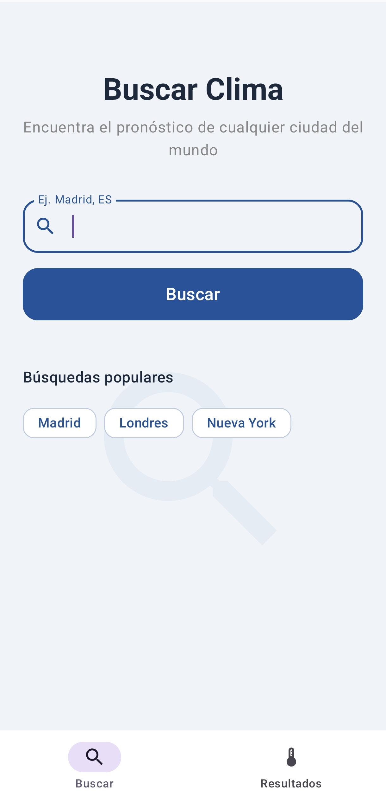
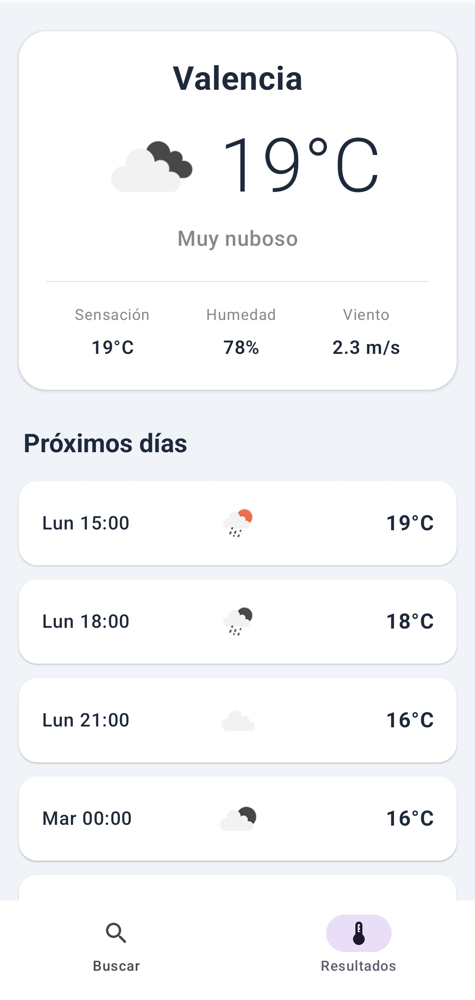

 

# ¡Hola! Soy Alejandro 👋

### 💻 Desarrollador de Aplicaciones Multiplataforma

Estudiante de **2º DAM**, apasionado por la programación, el desarrollo de software y las nuevas tecnologías.

---

## 👨‍💻 Sobre mí

- 🎓 Estudiante de **2º de Desarrollo de Aplicaciones Multiplataforma (DAM)**.
- 💡 Interesado en el desarrollo de aplicaciones y la programación.
- 🚀 Aprendiendo nuevas tecnologías y mejorando mis habilidades.
- 🛠️ Me gusta desarrollar proyectos prácticos y resolver problemas mediante código.

## 🧰 Tecnologías y herramientas

### Lenguajes de programación

### Herramientas y tecnologías

## 📂 Proyectos destacados

| Proyecto | Descripción | Tecnologías |
|---|---|---|
| 🎬 Filmoteca | Aplicación Android para consultar películas | Kotlin, Jetpack Compose |
| 🌤️ Weather App | Aplicación para consultar información meteorológica | Kotlin, Retrofit, API |
| 🍔 GastroManager | Sistema de gestión para un restaurante | Java, SQL, Docker |
| 📦 Gestión de stock | Aplicación para gestionar productos y pedidos | Java, JSON, XML |

## 📂 Proyectos destacados

### 🌤️ WeatherApp
Aplicación Android para consultar el tiempo
mediante OpenWeather API.

**Tecnologías:** Kotlin, Jetpack Compose, Retrofit.

[Weatherapp](https://github.com/ACabrero07/Weatherapp.git)

<h2 align="center">📱 Preview</h2>

  
  

---

### 📫 Contacto

¿Quieres contactar conmigo o conocer mis proyectos?

**¡Gracias por visitar mi perfil!** 🚀

